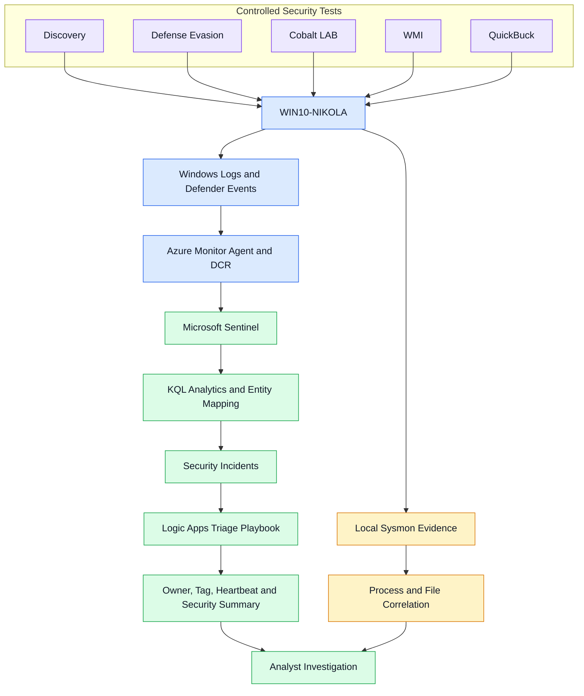

# Purple Lab — Microsoft Sentinel Detection Validation

### Adversary Emulation · Ransomware Triage · SOAR Automation

## Project Overview

This project documents controlled security tests in my Purple Lab environment, connecting Windows activity with endpoint protection, custom KQL analytics, Sentinel incidents and automated investigation context.

The work covers discovery, masquerading, account changes, service execution, WMI event subscriptions and ransomware simulation. Each scenario includes evidence screenshots, observed results and validation limits.

Full reports are available in English and Serbian.

## Lab Workflow

The workflow connects controlled test activity with Windows telemetry, Sentinel analytics, incident enrichment and analyst investigation.

Sysmon process and file correlation was validated locally. Ingestion of those records and bulk-encryption alerting in Sentinel remain unconfirmed. The diagram represents the investigation workflow; individual detection outcomes are documented below.

## Environment

| Component | Role |
|---|---|
| WIN10-NIKOLA | Windows domain endpoint used for the documented tests |
| Kali Linux | Test preparation, HTTP file delivery and lab HTTP receiver |
| Microsoft Defender Antivirus | Threat detection, prevention and remediation |
| Sysmon | Local process creation and file creation evidence |
| Windows event logs | Process, authentication, PowerShell and security records |
| Azure Monitor Agent and DCR | Collection of selected Windows event logs |
| Microsoft Sentinel | KQL analysis, analytics rules, entity mapping and incidents |
| Azure Logic Apps | Automated incident triage and enrichment |

## Documented Scenarios

| Scenario | Validation focus | Verified outcome |
|---|---|---|
| Discovery | Host information, identity and local group discovery | Process telemetry, a Sentinel incident and playbook enrichment |
| Masquerading and account changes | Disguised files and archives, Guest account changes | Five correlated indicators, Sentinel incidents and automation |
| Cobalt LAB behavior | Named-pipe patterns, temporary service execution and HTTP requests | Process and service evidence, Defender remediation and Sentinel correlation |
| WMI event subscription | Registration, trigger behavior and control after cleanup | Local registration and control evidence; custom Sentinel detection pending validation |
| QuickBuck ransomware simulation | AV prevention, test-file encryption and incident triage | Defender detections processed in Sentinel and 10,001 `.enc` files correlated locally through Sysmon |

## QuickBuck Execution and Triage

Defender initially detected and quarantined the executable. A subsequent attempt was also interrupted when Defender blocked the staged WINWORD.EXE copy.

The completed test used newly created test documents and a temporary exclusion for the original executable. Macro simulation and shadow copy deletion were disabled.

Local investigation confirmed:

- Process creation with its parent process, command line and SHA256.
- Correlation of process and file events through the same ProcessGuid.
- Creation of 10,001 `.enc` files and a ransom note.
- Successful completion with ExitCode 0.

Defender detections were available in Sentinel. The completed encryption test was supported by local Sysmon evidence; Sentinel detection of bulk encryption remains unconfirmed.

## SOAR Automation

The incident workflow uses the `PURPLE-LAB-T1082-Triage` playbook to provide investigation context.

Confirmed outputs include:

- Incident owner assignment and the `PURPLE-LAB` tag.
- An automated incident-triage checklist.
- An agent Heartbeat overview.
- A summary of selected Windows Security events.

Entity mapping was corrected to represent the hostname and DNS domain within one Host entity, and the filename and directory within one File entity.

The analyst reviews the enriched incident and determines classification and response actions.

## Evidence and Validation

The reports include console output, Windows event records, process relationships, Sentinel incident views and playbook activity.

Results distinguish between completed actions, prevented attempts, locally observed telemetry and confirmed Sentinel detections. Cropped and redacted screenshots are identified in their captions.

All documented activity was performed in a personal lab using test artifacts.

## Full Reports

- [Read the English report](./Purple_Lab_Report_EN.pdf)
- [Pročitaj izveštaj na srpskom](./Purple_Lab_Izvestaj_SRB.pdf)

## Author

**Mladen Starčević**

Cyber Defense · Detection Engineering · Incident Response
